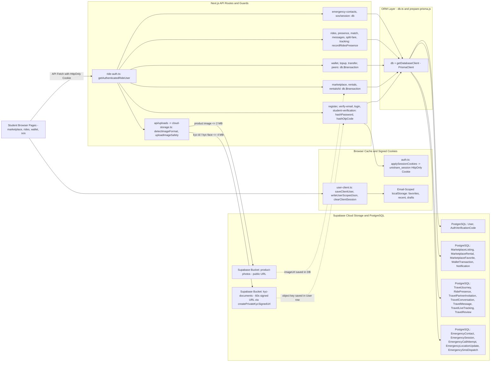

# UniShare — Data Storage Architecture & Database Guide

> Prepared for academic review and instructor inspection. Every model, column, storage bucket, and cookie listed here reflects the live implementation in `prisma/schema.prisma`, `src/app/lib/cloud-storage.ts`, `src/app/lib/auth.ts`, `scripts/prepare-prisma.js`, and `src/app/lib/user-client.ts`.

---

## 1. Storage Overview (Three Storage Layers)

UniShare separates data cleanly into **three storage tiers** based on sensitivity and access pattern:

| Layer | Technology | What Is Stored | Why |
| :--- | :--- | :--- | :--- |
| **1. Relational Database** | **PostgreSQL** (Supabase / Neon in production) or **SQLite** (local dev fallback) via **Prisma ORM v6** | All **19 normalized tables**: user accounts, hashed OTPs, marketplace listings, rentals/escrow, wallet ledgers, rides, messages, notifications, and SOS records | ACID transactions (`db.$transaction`) keep token balances, rental state, and ledger entries consistent across concurrent users |
| **2. Object / File Storage** | **Supabase Storage** (`product-photos` public bucket & `kyc-documents` private bucket) | Uploaded marketplace item images (JPG/PNG/WebP, `<= 2 MB`) and confidential Student ID / face selfie KYC images (`<= 4 MB`) | Binary images stay out of relational rows; KYC documents live strictly in a private bucket accessible only via short-lived 60-second signed URLs |
| **3. Browser Session & Cache** | **HMAC-SHA256 Signed Cookies** + Email-Scoped `localStorage` | Authenticated session token (`unishare_session`), pending OTP/reset state cookies, and per-user UI caches (`favorites`, `recently_viewed`, drafts) | Fast page hydration without exposing passwords, `studentId`, private `gender`, or another user's cached items on shared devices |

### Automatic PostgreSQL / SQLite Switch (`scripts/prepare-prisma.js` & `src/app/lib/db.ts`)
- Before `prisma generate`, `next dev`, or `next build`, [`scripts/prepare-prisma.js`](../scripts/prepare-prisma.js) inspects `DATABASE_URL`:
  - `postgres://` or `postgresql://` → sets `provider = "postgresql"` (with `DIRECT_URL` if configured).
  - `file:...` or unset → sets `provider = "sqlite"` for zero-cloud local development.
- In read-only production/serverless environments running SQLite fallback, [`src/app/lib/db.ts`](../src/app/lib/db.ts) copies `prisma/dev.db` to `/tmp/dev.db` cleanly.

---

## 1B. End-to-End Data Storage Flow Diagram (Code Functions → Supabase)



---

## 2. Database Schema — All 19 Prisma Models (`prisma/schema.prisma`)

### A. Accounts & Email Verification

| Model | Primary Purpose | Key Fields Stored | Security / Privacy Handling |
| :--- | :--- | :--- | :--- |
| **`User`** | Verified student accounts | `id`, `email` (unique), `fullName`, `studentId`, `university`, `universityId`, `isCustomUniversity`, `department`, `programme`, `academicSession`, `passwordHash`, `emailVerified`, `verified`, `tokenBalance` (default `50`), `gender`, `idCardPhotoPath`, `facePhotoPath`, `preferencesJson`, `createdAt`, `updatedAt` | Password stored as salted `scrypt$<salt>$<hash>`. `gender` and KYC paths are never leaked to ride search or wallet directory APIs |
| **`AuthVerificationCode`** | Email registration OTP & password reset codes | `id`, `email`, `purpose` (`EMAIL_VERIFY` \| `PASSWORD_RESET`), `codeHash`, `expiresAt`, `attempts`, `consumedAt`, `createdAt` | Only `HMAC-SHA256` digest stored (`codeHash`); plaintext 6-digit OTP is never persisted (`15 min` expiry, max `6` attempts) |

### B. Peer Marketplace, Escrow & Campus Wallet

| Model | Primary Purpose | Key Fields Stored | Relationships / Notes |
| :--- | :--- | :--- | :--- |
| **`MarketplaceListing`** | Student-listed borrowable gear | `id`, `sellerId`, `sellerEmail`, `sellerName`, `sellerInitials`, `university`, `title`, `category`, `condition`, `rate`, `deposit`, `area`, `maxRentalDays`, `description`, `imageUrl`, `status` (`active` \| `paused` \| `draft`), `isRentedOut`, `available`, timestamps | Linked to `User` (`onDelete: Cascade`); indexed on `sellerId`, `status`, `category`, `createdAt` |
| **`MarketplaceRental`** | Rental requests & token escrow records | `id`, `listingId`, `listingTitle`, `listingImage`, `borrowerId`, `borrowerName`, `borrowerEmail`, `lenderId`, `lenderName`, `lenderEmail`, `startDate`, `endDate`, `days`, `ratePerDay`, `rentalFee`, `depositAmount`, `totalLocked`, `note`, `status` (`PENDING` \| `ACTIVE` \| `RETURNED` \| `DECLINED` \| `CANCELLED`), `returnedAt` | `totalLocked = rentalFee + depositAmount` deducted atomically when requested; refunded on decline/cancel or deposit released on return |
| **`MarketplaceFavorite`** | Saved/hearted campus items per user | `id`, `userId`, `listingId`, `createdAt` | Composite unique index `@@unique([userId, listingId])` prevents duplicates |
| **`WalletTransaction`** | Immutable-style audit trail of token changes | `id`, `userId`, `type` (`TOPUP`, `TRANSFER_IN`, `TRANSFER_OUT`, `RENTAL_HOLD`, `RENTAL_REFUND`, `RENTAL_EARN`, `BONUS`), `title`, `subtitle`, `amount` (signed +/- integer), `balanceAfter`, `referenceId`, `status`, `createdAt` | Written inside the same `db.$transaction` as every balance update in `User.tokenBalance` |
| **`Notification`** | In-app alerts for rentals, rides & wallet | `id`, `userId`, `category` (`marketplace`, `rides`, `ride`, `wallet`, `verification`, `safety`), `title`, `body`, `actionLabel`, `actionHref`, `unread`, `createdAt` | Polled live across navbar badge & `/notifications`; marked read per item or all at once |

### C. Campus Ride Matching, Chat, Live Telemetry & Reviews

| Model | Primary Purpose | Key Fields Stored | Notes |
| :--- | :--- | :--- | :--- |
| **`TravelJourney`** | Student route corridor posts | `id`, `userId`, `origin`, `originLat`, `originLng`, `destination`, `destinationLat`, `destinationLng`, `departureTime`, `genderPreference` (`no_preference` \| `women_only` \| `men_only`), `status` (`ACTIVE` \| `COMPLETED` \| `CANCELLED`), `notes` | Powers destination/corridor companion matching & auto cost-savings estimates |
| **`RidePresence`** | Real-time active map explorers | `id`, `userId` (unique), `lat`, `lng`, `pickupLocation`, `destinationLocation`, `destinationLat`, `destinationLng`, `genderPreference`, `updatedAt`, `expiresAt` | Persisted in PostgreSQL (no volatile in-memory Map loss across serverless restarts) |
| **`TravelPartnerInvitation`** | Peer-to-peer co-travel requests | `id`, `senderId`, `receiverId`, `journeyId`, `status` (`PENDING` \| `ACCEPTED` \| `REJECTED` \| `CANCELLED`), `message`, timestamps | Reuses open invitations instead of duplicating on repeated clicks; triggers notification alerts |
| **`TravelConversation`** | Private matched-pair coordination room | `id`, `invitationId` (unique), `participant1Id`, `participant2Id`, `meetingLocation`, `meetingLat`, `meetingLng`, `meetingConfirmed`, `status` (`ACTIVE` \| `ARCHIVED`) | Strictly restricted (`403 Forbidden`) to `participant1Id` and `participant2Id` |
| **`TravelMessage`** | Private messages, meeting spots & fare splits | `id`, `conversationId`, `senderId`, `senderName`, `text`, `messageType` (`TEXT` \| `MEETING_LOCATION` \| `STATUS_UPDATE`), `locationName`, `locationLat`, `locationLng`, `createdAt` | Supports quick text chat, confirmed meetup pins, and token fare-split receipts |
| **`TravelLiveTracking`** | Dual-consent live GPS sharing & arrival detection | `id`, `conversationId` (unique), `participant1Consent`, `participant2Consent`, `participant1Sharing`, `participant2Sharing`, `p1Lat`/`p1Lng`/`p1Accuracy`/`p1Heading`/`p1Speed`/`p1UpdatedAt`, `p2Lat`/`p2Lng`/`p2Accuracy`/`p2Heading`/`p2Speed`/`p2UpdatedAt`, `journeyStatus` (`NOT_STARTED` \| `IN_PROGRESS` \| `COMPLETED` \| `CANCELLED`), `destinationLat`, `destinationLng`, `destinationName`, `proximityThresholdMeters` (`100` m default), arrival flags/timestamps | Requires both students' explicit opt-in consent before sharing live coordinates |
| **`TravelReview`** | Post-ride ratings & confidential safety reports | `id`, `conversationId`, `reviewerId`, `partnerId`, `rating` (`1–5`), `feedback`, `reported`, `reportCategory`, `reportDetails`, `createdAt` | Unique per `(conversationId, reviewerId)` |

### D. Emergency SOS & Live Safety Tracking

| Model | Primary Purpose | Key Fields Stored | Notes |
| :--- | :--- | :--- | :--- |
| **`EmergencyContact`** | Priority-ranked campus/family contacts | `id`, `userId`, `name`, `phoneNumber`, `relationship`, `priority` (`1–5`), timestamps | Protected by session ownership checks (`403`/`404` for other users) |
| **`EmergencySession`** | Active or resolved SOS incident state | `id`, `userId`, `status` (`ACTIVE` \| `RESOLVED` \| `CANCELLED`), `callingStatus`, `triggerReason`, `resolvedReason`, `answeredContactId`, `activeCallSid`, `trackingToken` (unique), `latestLatitude`, `latestLongitude`, `latestAccuracy`, `latestLocationAt`, `gpsStatus`, `resolvedAt` | `trackingToken` is high-entropy cryptographic random token powering `/sos/track/[token]` |
| **`EmergencyCallAttempt`** | Telephony escalation log per contact | `id`, `sessionId`, `contactId`, `contactName`, `phoneNumber`, `priority`, `attemptNumber`, `status`, `provider` (`TWILIO` \| `MOCK_SIMULATOR`), `telephonySid`, `durationSeconds`, `errorMessage`, `notes` | Records call outcomes step by step across priorities 1→5 |
| **`EmergencyLocationUpdate`** | Time-series GPS trail during active SOS | `id`, `sessionId`, `latitude`, `longitude`, `accuracy`, `heading`, `speed`, `timestamp` | Feeds the emergency tracking viewer in real time |
| **`EmergencySmsDispatch`** | Outbound SMS / WhatsApp dispatch audit log | `id`, `sessionId`, `contactId`, `recipientName`, `phoneNumber`, `messageBody`, `status`, `provider`, `telephonySid`, `errorMessage`, `sentAt` | Tracks message delivery status and timestamps |

---

## 3. Uploaded Images & Private KYC Storage (`src/app/lib/cloud-storage.ts`)

Every upload through `POST /api/uploads` enforces:
1. Authenticated student session (`401` otherwise).
2. Binary **magic-byte header inspection** (`detectImageFormat` verifies JPEG `FF D8 FF`, PNG `89 50 4E 47 0D 0A 1A 0A`, or WebP `RIFF....WEBP`—SVG and HTML scripts are blocked even if renamed `.jpg`).
3. File size limits: `2 MB` for marketplace product photos (`product`), `4 MB` for Student ID / face selfie KYC uploads (`kyc-id`, `kyc-face`).

Where files go:
- **Marketplace Product Photos (`product`)**:
  - Uploaded to Supabase public bucket `product-photos` (`SUPABASE_PRODUCTS_BUCKET`) at key `products/<userId>/product-<uuid>.<ext>`.
  - Public URL saved in `MarketplaceListing.imageUrl`.
  - If Supabase Storage keys are omitted locally, falls back safely to a base64 `data:image/...` URI without writing files to disk.
- **Student ID Card & Selfie Photos (`kyc-id`, `kyc-face`)**:
  - Uploaded to Supabase **private** bucket `kyc-documents` (`SUPABASE_KYC_BUCKET`) at key `kyc/<userId>/<kind>-<uuid>.<ext>`.
  - Only the object path (`User.idCardPhotoPath`, `User.facePhotoPath`) is saved in PostgreSQL—**public URLs are never generated**.
  - Viewing requires `GET /api/uploads/signed-url`, which verifies session ownership and mints a `60`-second signed URL.
  - When Supabase Storage keys are absent locally, records `verified-upload://<fileKey>` without saving sensitive KYC photos on the local filesystem.

---

## 4. Browser Cookies & Client Storage (`src/app/lib/auth.ts`, `src/app/lib/user-client.ts`)

### Signed HTTP Cookies (Server-Issued)
- `unishare_session` — Active login session (`HMAC-SHA256` signed payload with expiration).
- `unishare_pending_verify` — Short-lived signed signup + OTP verification payload during email confirmation.
- `unishare_pending_reset` — Signed password-reset verification window cookie.
- `unishare_verified_account` — Signed verified-profile snapshot for serverless cold-start consistency.
- `unishare_known_accounts` — Signed list of canonical emails verified in this browser to block duplicate alias signups.
- Protected session cookies use `HttpOnly`, `SameSite=Lax`, and `Secure` flags in production.

### Browser `localStorage` (UI Cache Only — Never Passwords or KYC Photos)
- Active user snapshot: `unishare_logged_in`, `unishare_user` (mirrors `PublicUser` fields synced with `GET /api/auth/me`).
- Email-isolated per-user keys (`getUserScopedKey` appends `_<email>` for every student):
  - `unishare_favorites_<email>`
  - `unishare_recently_viewed_<email>`
  - `unishare_my_products_<email>`
  - `unishare_marketplace_items_<email>`
  - `unishare_emergency_contacts_<email>`
- On logout, `clearClientSession()` clears session flags, cookies, and any legacy unscoped keys so the next user on a shared computer starts cleanly.

---

## 5. How Your Teacher Can View the Stored Data

1. **Visual Database Browser (Recommended Locally): Prisma Studio**
   Run in the project folder and open **http://localhost:5555** in a browser:
   ```bash
   npx prisma studio
   ```
   This displays all **19 tables** (`User`, `MarketplaceListing`, `MarketplaceRental`, `WalletTransaction`, `TravelJourney`, `EmergencySession`, etc.) with live filtering and relationships.

2. **Cloud Database & Buckets (Supabase Dashboard)**
   - **Table Editor**: Inspect PostgreSQL rows across all 19 tables in real time.
   - **Storage**: Inspect public `product-photos` and private `kyc-documents` buckets directly.

3. **Live Application Views (As a Logged-In Student)**
   - **Wallet Ledger (`/wallet`)**: Shows `User.tokenBalance`, held rental deposits, and `WalletTransaction` history.
   - **Marketplace & Orders (`/marketplace`, `/my-products`)**: Shows `MarketplaceListing` and `MarketplaceRental` records.
   - **Rides (`/rides`)**: Shows active `TravelJourney`, `RidePresence`, `TravelPartnerInvitation`, and `TravelConversation` threads.
   - **Notifications (`/notifications`)** & **SOS (`/sos`)**: Show persisted `Notification`, `EmergencyContact`, and `EmergencySession` records.

---

## 6. Why Nobody Can See Original Passwords (`src/app/lib/auth.ts`)

Neither developers, instructors inspecting Prisma Studio/Supabase, nor anyone with database read access can see a student's original plaintext password:

1. **One-Way Salted `scrypt` Key Derivation (`hashPassword`)**
   - When registering or updating a password, [`hashPassword`](../src/app/lib/auth.ts) generates a unique `16`-byte cryptographic random salt (`crypto.randomBytes(16).toString("hex")`) and derives a `64`-byte key via `crypto.scryptSync(password, salt, 64)`.
   - Only `scrypt$<salt>$<hash>` is saved in `User.passwordHash`—there is no decryption key or reverse algorithm anywhere in the app.
2. **Constant-Time Verification (`verifyPassword`)**
   - On login, the server re-computes `crypto.scryptSync(enteredPassword, salt, 64)` using the stored salt and compares the two buffers using `crypto.timingSafeEqual(derived, storedBuf)`.
3. **Stripped From Public Responses & OTPs**
   - `toPublicUser` excludes `passwordHash` and private KYC keys before returning user JSON to cookies or `localStorage`.
   - 6-digit email OTPs are similarly stored only as `HMAC-SHA256` digests (`hashOtpCode`) and checked with `crypto.timingSafeEqual` (`verifyOtpHash`).

---

## 7. Exact Code That Stores Data Into Supabase

- **Supabase PostgreSQL Connection**:
  - `prisma/schema.prisma` connects via `DATABASE_URL` and `DIRECT_URL` (`provider = "postgresql"`).
  - `scripts/prepare-prisma.js` ensures `postgresql` is selected whenever `DATABASE_URL` uses `postgres://` or `postgresql://`.
  - `src/app/lib/db.ts` exports the shared Prisma singleton `db` (`getDatabaseClient()`), used by every route to execute `.create()`, `.update()`, `.upsert()`, and `$transaction()`.
- **Example Atomic Write (`src/app/api/marketplace/rentals/route.ts`)**:
  - Inside `await db.$transaction(async (tx) => { ... })`, deducting `User.tokenBalance`, creating `MarketplaceRental`, logging `WalletTransaction`, and notifying the lender in `Notification` succeed or roll back together.
- **Supabase Storage Buckets (`src/app/lib/cloud-storage.ts`)**:
  - `uploadImageSafely` inspects image magic bytes (`detectImageFormat`), checks size limits (`<= 2 MB` product, `<= 4 MB` KYC), and sends a `POST` request to `${supabase.url}/storage/v1/object/${bucket}/${fileKey}`.
  - Product photos go to `product-photos` (public URL saved in `MarketplaceListing.imageUrl`); Student ID and face KYC uploads go to private `kyc-documents` and open only via `60`-second signed links minted by `createPrivateKycSignedUrl`.

---

## 8. Why Next.js APIs (`src/app/api/*`) Are Used Instead of Direct Browser-to-Database Access

1. **Hide Server Secrets**: `DATABASE_URL`, `AUTH_SECRET`, `SUPABASE_SERVICE_ROLE_KEY`, Resend, and Twilio credentials live exclusively on the server.
2. **Enforce Authentication & Ownership**: Protected endpoints verify the signed `HttpOnly` `unishare_session` cookie via `getAuthenticatedSessionUser` / `getAuthenticatedRideUser` (`src/app/lib/ride-auth.ts`) and reject strangers (`401` / `403`), such as checking conversation membership in `src/app/api/rides/conversations/[id]/route.ts`.
3. **Prevent Client Tampering**: Token balances, self-borrow blocking, escrow holds, and upload byte validation run atomically on the server regardless of client edits.
4. **Filter Sensitive Columns**: APIs return minimized public views (excluding `passwordHash`, private `gender`, `studentId`, and KYC keys) across multi-user features.
5. **Coordinate External Services & Live Peers**: OTP emails, Twilio SOS alerts, private storage signing, and cross-student updates flow safely through server routes.

